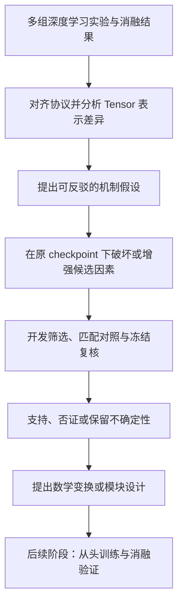

# 深度学习 Tensor 逆向增强 Skill：利用多组实验结果寻找更有利的 Tensor 数据结构

**从实验差异出发，通过受控干预指导新模块设计的研究工作流。**

[English](README.en.md) · [Skill 入口](SKILL.md) · [给其他 AI 的使用说明](AI_USAGE.md) · [MIT 许可证](LICENSE)

这是一个专门面向**深度学习模型**、供 AI 编程与研究助手使用的提示词 skill。它帮助研究者比较多组训练或消融实验，分析中间 tensor 的状态，提出可检验的假设，再通过原 checkpoint 下的受控干预，为后续增强变换、特征融合与模块设计提供依据。它不面向一般工程实验或非深度学习系统的通用优化。

标题中的“Tensor 数据结构”指特征分布、跨通道或跨分支关系、时空模式、频谱等表示结构，不是编程语言的数据结构或内存存储格式。“寻找更有利的结构”描述研究目标，是否有利仍需实验检验。技术调用名保留为 `reverse-engineer-experiments`。

**本项目不保证任何下游任务的准确率或其他指标提高，也不保证一定找到有效变换、正确机制或有创新性的新模块。** 固定权重下的干预有效，不等于所提出的机制已经得到因果证明，更不等于将其写成模块并从头训练后仍然有效。

## Background：为什么设计这个 skill

这个想法来自逆向工程的启发。我希望探索一种面向深度学习的逆向推理优化方法。

在我个人优化机器学习算法的过程中，通常会经历这样的循环：

> 阅读文献 → 发现模块 → 分析它是否可能有效 → 融入自己的模型 → 训练并观察结果 → 判断是否值得保留。

这个过程可以逐步改进模型，但大量时间花在了尝试不同模块上。在真正测试之前，我往往不知道某个模块是否适合自己的数据、任务和现有模型。一个模块在其他研究中有效，并不能直接回答它在我的模型中能解决什么问题。

于是我想到：能不能从 tensor 的角度入手，让大模型利用分析代码检查已有实验的中间特征，比较几次实验中好结果与差结果的差异？表现较好时，tensor 中出现了怎样的分布、关系或局部结构？哪些差异可能有利于当前任务？什么操作可能进一步促进这种结构？

仅仅给出解释还不够。我希望让大模型按照自己的假设调制 tensor，再把修改后的 tensor 接回原模型，沿用原 checkpoint 的权重进行推理，观察任务指标是否真的改善。这样可以在训练新模块之前，先检验某种改变是否值得继续研究。

我最初的直觉是：“如果准确率提高了，可能就找对了有利结构。”在这个 skill 中，这被处理为一个需要对照和复核的研究判断：**干预后的改善是候选有利因素的证据，而不是对唯一原因的证明。** 收益也可能与尺度、归一化、参数选优或特定 checkpoint 的适配有关，需要逐步排查。

如果这种改变经受住适当的检验，下一步才是尝试把“促进候选有利结构的方法”融入模型，形成数学变换或新的模块，再从头训练并进行消融验证。这个工作流的目标是为模块尝试提供更具体的依据；它是否能减少试错成本、提高最终效果，仍需在使用者的任务中检验。

## 工作方式



1. 核对数据划分、样本顺序、预处理、checkpoint 和指标口径，复现基线。
2. 对比逐样本结果和特征关系；可使用能量、时序、频谱、跨路关系或可选探针筛选假设。
3. 在同一固定模型内构造选择性破坏、增强、恒等和适当的匹配对照，检查操作是否真的改变目标因素。
4. 在开发数据上进行有预算的搜索；需要组合时，检验组合是否优于最强单项。
5. 冻结配置后复核，保留无效、负向与不确定的结果，并持续维护实验日志。
6. 将证据转化为结构建议；在明确开展下一阶段时，再实现模块、训练并验证。

“让大模型分析 tensor”通常意味着让具有文件和代码执行能力的助手编写、运行统计与干预脚本，检查可复现的产物。它不要求把全部 tensor 数值粘贴进对话，也不意味着模型能凭文字解释直接确定因果关系。

## 当前能力与模块设计的边界

当前版本是研究流程和提示词材料，主要覆盖差异分析、干预设计与搜索、复核、记录和结构建议。它不附带可直接适配所有模型的 tensor 分析器、神经网络模块库或自动训练平台。

候选操作不局限于参考文件中的简单算子。模块可以是确定性计算、输入驱动的规则或可学习结构；实现方式应由证据、部署输入和实验约束决定。具有代码能力的助手可以据此编写项目专用实现，但本仓库没有验证一个端到端的通用模块生成器。

从干预到模块时，需要重新说明输入输出维度、插入点、参数化、初始化、归一化与计算成本。新模块的价值仍需与原模型、适当的简单变换及等预算对照比较。固定 checkpoint 上失败的干预，也不能单独排除某个结构在重训练后的价值。

## 适用范围

以下场景均以深度学习模型为对象，研究核心是模型的 Tensor 表示及其可验证干预。

| 场景 | 可以使用本 skill 做什么 |
| --- | --- |
| 深度学习模型或消融实验有性能差异 | 提出可检验的特征与机制假设 |
| 可访问 checkpoint 和中间 tensor | 固定权重下进行特征干预与推理复核 |
| 多分支、多尺度、时序或融合结构 | 检查共性、差异、对齐、局部统计及交互关系 |
| 深度模型中已有若干候选特征变换或模块 | 检查单项、组合、顺序和条件贡献 |
| 只有深度模型的逐样本预测，尚未提取中间 Tensor | 先定位差异并规划特征提取；不能据此宣称完成 Tensor 逆向增强 |
| 深度学习分类、回归、神经检索等任务 | 根据模型的 Tensor 语义选择指标、统计单位和干预方式 |

一般工程试验、传统非神经模型调参、纯规则排序或只对任意系统分数做组合，不属于本 skill 的适用范围。不能仅凭“有多组实验结果”就使用它。

以下情况需要缩小结论或补充材料：

- 只有总准确率、没有配对样本或可重放模型：可以讨论假设，不能完成内部特征验证。
- 不同实验的数据划分或推理协议不同：先排查可比性，不能直接将差异归因于模块。
- 隐藏表示来自独立训练的模型：同编号通道未必具有相同语义，不能直接互换。
- 只有已经反复查看的测试数据：可以探索，但不能继续称为未见数据上的盲测。
- 纯聊天助手没有代码执行能力：可以辅助制定方案和审阅结果，不能声称已经运行推理。

本 skill 不用于保证自动发现新架构、替代训练验证，或仅将现有指标改写为结果报告。它不绑定特定数据集、模型、分支数、硬件或成功数量。

## 安装与使用

### 在 Codex 中安装

如果环境提供 `$skill-installer`，可以直接告诉它：

```text
使用 $skill-installer 安装 GitHub 仓库
https://github.com/Harry1213814/reverse-engineer-experiments
中的 skill。SKILL.md 位于仓库根目录（path 为 .），
安装名使用 reverse-engineer-experiments。
```

也可以将整个仓库克隆到当前 Codex 文档规定的用户技能目录。只选择一种安装方式，避免同名副本。

macOS / Linux：

```bash
mkdir -p "$HOME/.agents/skills"
git clone https://github.com/Harry1213814/reverse-engineer-experiments.git "$HOME/.agents/skills/reverse-engineer-experiments"
```

Windows PowerShell：

```powershell
$skillParent = Join-Path $env:USERPROFILE '.agents\skills'
New-Item -ItemType Directory -Force -Path $skillParent | Out-Null
git clone https://github.com/Harry1213814/reverse-engineer-experiments.git (Join-Path $skillParent 'reverse-engineer-experiments')
```

若目标目录已存在，先检查已有安装，不覆盖用户修改。部分环境的内置安装器使用 `$CODEX_HOME/skills` 或 `~/.codex/skills`，应以该环境的安装器说明为准。安装后通过技能列表或显式名称调用；未显示时重新加载客户端。目录发现与调用行为参见 [OpenAI 官方 skill 文档](https://learn.chatgpt.com/docs/build-skills)。

### 第一次调用

```text
使用 $reverse-engineer-experiments。

多组深度学习实验与结果位置：[路径，以及各实验改变了什么]。
参考模型与 checkpoint：[路径]。
数据、推理代码和已知划分：[路径或说明]。
待分析的 Tensor 层、轴语义与希望改善的问题：[说明]。
主指标和成功标准：[指标、统计单位、最小收益等]。
允许修改的位置：[模型层、tensor 或组合公式]。
训练权限：[本轮冻结主模型权重；辅助探针/校准是否允许]。
开发与复核数据的历史使用：[哪些结果已经查看或用于调参]。
预算与输出目录：[时间、算力、次数、路径]。

先核对材料，讨论影响实验有效性的缺失信息并制定计划。
执行时维护 EXPERIMENT_LOG.md，记录每一步目的、配置、结果、
对照与下一步。最终区分实测收益、机制假设和待训练的模块建议。
```

只需要方案时明确写“本次不运行实验”。已经准备好执行时写清授权范围，助手应继续完成范围内的工作。

### 进入模块实现与训练阶段

```text
继续使用 $reverse-engineer-experiments。
基于 [已保存的干预报告]，提出有证据依据的模块设计，
说明接口、数学表达、参数化、计算成本和可能的失败原因。
本轮允许 [仅编写模块 / 接入模型 / 按指定预算从头训练]。
使用 [训练与复核协议] 比较原模型、简单变换和候选模块。
不能把固定 checkpoint 的收益当作新模块训练效果的保证。
```

这一阶段依赖使用者项目中的模型、训练入口和计算资源；本仓库没有预置这些实现。

## 其他 AI 如何下载并使用

入口是 [AI_USAGE.md](AI_USAGE.md)。支持 Agent Skills 格式的宿主可以将整个目录作为一个 skill 加载；不支持原生 skill 的助手可以读取 `SKILL.md`，再按其链接读取相关参考文件，把它们用作当前任务的研究方法指导。

下载时可使用上面的 `git clone`，或仓库页面的 **Code → Download ZIP**。保留 `SKILL.md`、`references/`、`agents/` 和 `LICENSE` 的相对结构，不要只复制一段简介。要复现实验流程，记录下载时的 commit；公开仓库可供获取，但不保证任何搜索引擎或 AI 平台已经收录。

## 文件与产物

| 文件 | 用途 |
| --- | --- |
| [SKILL.md](SKILL.md) | AI 的主指令与适用触发条件 |
| [references/experiment-design.md](references/experiment-design.md) | 假设筛选、探针、干预、组合与结构推导 |
| [references/execution-and-records.md](references/execution-and-records.md) | 预算、冻结、恢复、日志模板与调用方式 |
| [agents/openai.yaml](agents/openai.yaml) | Codex 展示与调用元数据 |
| [AI_USAGE.md](AI_USAGE.md) | 其他 AI 的获取与使用入口 |

运行研究后，通常应得到实验约定、基线重放结果、候选及失败记录、干预和对照结果、冻结复核记录、`EXPERIMENT_LOG.md`，以及可追溯到证据的数学表达或模块建议。实际产物根据任务与授权范围调整。

## 效果与验证状态

本 skill 来自作者个人的深度学习模型优化探索。已进行文件结构检查，以及固定权重特征干预情境的助手应用检查；这些检查评估的是工作流理解和决策，**不是对下游模型准确率提升的基准验证**。早期版本还做过检索系统组合情境检查，该检查不代表当前版本适用于一般检索工程或其他非深度学习实验。

本仓库不附带可复现的模型权重、私有实验数据或跨任务收益基准。单次涨点、开发集最优结果或一个 checkpoint 的表现都不能保证泛化。即使严格执行流程，也可能得到零个有效候选、负向结果或无法区分的解释；这些都应如实记录。

## 许可证

采用 [MIT License](LICENSE)。使用、修改或分发时保留许可证规定的版权与许可声明。MIT 的无担保条款同样适用；本项目另外明确不承诺科研结论、模块新颖性或任务性能收益。
